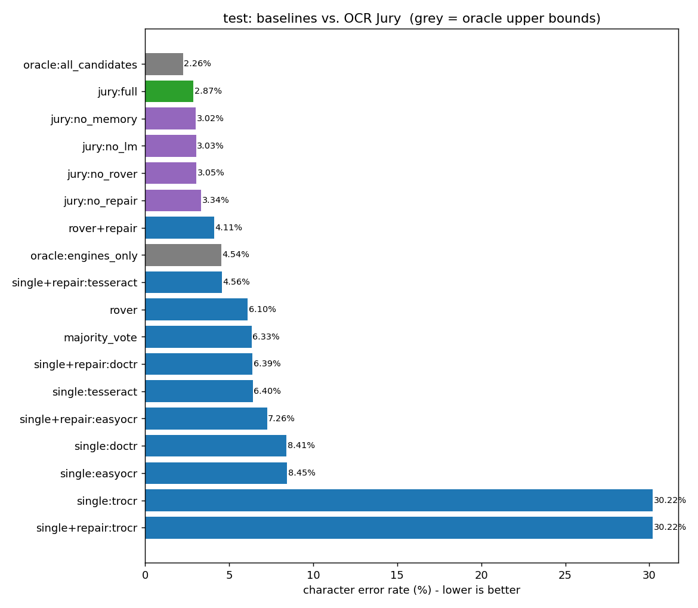
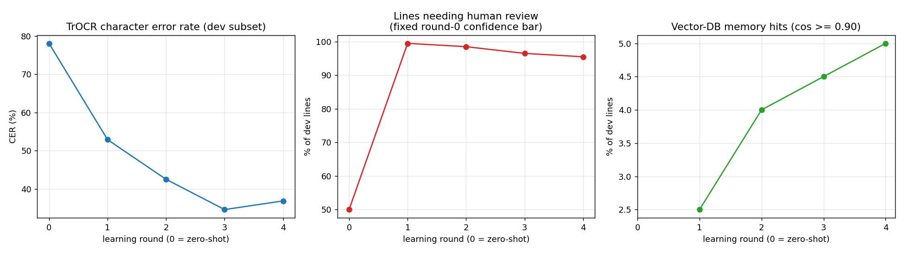
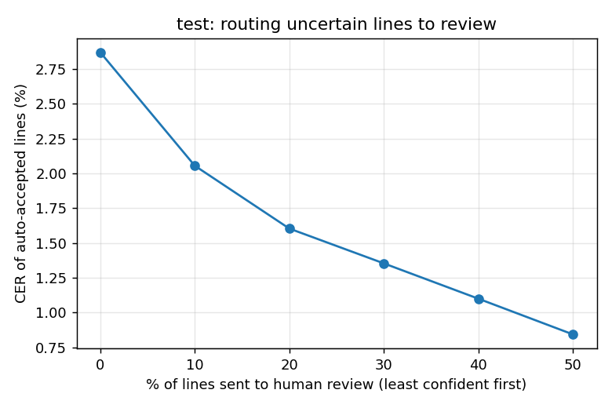

# OCR Jury

**A multi-engine OCR system for 18th-century printed books that cuts the
character error rate by 55% versus the best single engine — and knows which
of its own lines to send for human review.**

Four OCR engines read each line. The jury repairs a systematic historical
misreading (the long s, `ſ`), merges and generates candidate readings,
recalls past human corrections from a vector database, scores every
candidate, and routes low-confidence lines to a human. Those corrections
then fine-tune one of the engines, round after round.

Everything runs locally on a CPU laptop. No paid APIs.



## Headline results — held-out test set (1,056 lines, scored once)

| System | CER |
|---|---|
| Tesseract (best single engine) | 6.40% |
| Majority vote across engines | 6.33% |
| Word-level ROVER + long-s repair | 4.11% |
| Oracle: perfect choice among engine readings | 4.54% |
| **OCR Jury (4 engines)** | **2.87%** |
| Oracle: perfect choice among *all* jury candidates (ceiling) | 2.26% |

- **−55% CER** relative to Tesseract, and better than an oracle that always
  picks the best engine — possible only because the jury *generates*
  candidates no engine produced.
- **Calibrated confidence:** expected calibration error 0.041 for the jury vs.
  0.588 for Tesseract's own confidence score.
- **Human-review routing:** sending the least-confident 50% of lines to review
  leaves the auto-accepted half at **0.84% CER** (coverage curve below).

CER = character edits / reference characters, after normalization (long s →
s, typographic quotes and dashes folded, whitespace collapsed). An engine
reading `ſ` as `f` still counts as an error. A strict, un-normalized CER is
also computed for every system (see `outputs/jury/*/report.json`).

## Architecture

Editable diagram: [`docs/architecture.drawio`](docs/architecture.drawio) (open at [app.diagrams.net](https://app.diagrams.net)).

```
line image
   |
   +--> Tesseract --+
   +--> EasyOCR ----+
   +--> docTR ------+--> engine readings (+ each engine's own confidence)
   +--> TrOCR ------+    (TrOCR: fine-tuned on human corrections)
                    |
                    v
   candidate generation
     - every raw reading
     - long-s / dictionary repair of every reading   ("prifoner" -> "prisoner")
     - word-level ROVER merge (raw and repaired)
     - nearest past human corrections (Qdrant vector DB)
                    |
                    v
   feature scoring per candidate
     engine agreement | engine confidence | language-model likelihood (distilgpt2)
     dictionary match | vector similarity | edit distance to the readings
                    |
                    v
   reranker (gradient boosting) -> best candidate
   confidence model (logistic regression) -> P(line is acceptable)
                    |
          +---------+----------+
          v                    v
       ACCEPT            HUMAN REVIEW
                               |
                    corrected ground truth
                     |                  |
            TrOCR fine-tuning      Qdrant correction memory
                     +--------+---------+
                              v
                        next round
```

The long-s repair runs on **every** line, including lines where all engines
agree: engines very often agree on the *same* wrong reading (dev: 13 of the 21
lines where every engine agreed exactly were wrong, all from long s).

## Dataset

**OCR 18th Century training and testing dataset** (Zenodo, CC-BY 4.0) —
English test set: 9,981 line images from 18th-century printed books (mostly
Hume's *History of Great Britain*), each with a manual transcription. Only
the 1 GB test archive is downloaded, not the 7 GB bundle (see
`scripts/fetch_test_set.py`). Raw data is never committed.

### A leakage problem found and fixed

The dataset contains the **same Hume pages from two editions (1754 and
1762)**, identical line for line. A random line-level split put a dev line's
twin into the training pool: 29% of dev lines had a near-duplicate available
to the vector DB and TrOCR — which would have inflated both.

Fix: split by **page group**. Pages sharing identical text (edition twins)
are linked, and each group lands wholly in dev, test, or the training pool.
Linking uses only text that appears on exactly two pages; running headers
("THE HISTORY OF GREAT BRITAIN.") recur on many pages and at first chained 35
unrelated pages into one 1,455-line group. The split is stratified by source.

| Split | Lines | Purpose |
|---|---|---|
| dev | 671 | building and tuning (all model selection) |
| test | 1,056 | final numbers, scored once |
| pool | 8,254 | the only data used for training, the lexicon and the memory |

No page group is shared across splits (enforced by unit tests). After the
fix, near-duplicates in memory fell from 29% to 8% of dev lines — the rest are
genuinely repeated text such as headers.

## The engines

| Engine | Test CER alone | Notes |
|---|---|---|
| Tesseract 5.4 | 6.40% | single-line mode (`--psm 7`) |
| EasyOCR 1.7 | 8.45% | quantization disabled (see engineering log) |
| docTR 1.0 | 8.41% | full detection + recognition; recognition-only drops all spaces |
| TrOCR-small, fine-tuned | 30.22% | decoder fine-tuned on 600 reviewed pool lines |

The long s alone causes **19–28% of every engine's errors** (measured by also
folding f → s as a diagnostic).

## Ablations — what each component actually contributes

CER of the jury with one component removed. Each configuration was fixed in
advance; the test set was not used to choose anything.

| Configuration | Dev (3 eng.) | Test (3 eng.) | Dev (4 eng.) | Test (4 eng.) |
|---|---|---|---|---|
| **full jury** | 3.99% | 3.24% | 3.80% | **2.87%** |
| without long-s repair | 4.67% | 3.73% | 4.12% | 3.34% |
| without language model | 4.17% | 3.40% | 3.58% | 3.03% |
| without ROVER | 4.07% | 3.13% | 3.72% | 3.05% |
| without vector-DB memory | 3.90% | 3.20% | 3.69% | 3.02% |

| Component | Helped in | Verdict |
|---|---|---|
| Long-s / dictionary repair | 4 of 4 | **Clear, consistent gain** — the single most valuable component |
| Fine-tuned TrOCR as 4th engine | 2 of 2 (dev and test) | **Helps** (3.99 → 3.80 dev, 3.24 → 2.87 test) despite 30% CER alone: its errors differ from the others' |
| Language model | 3 of 4 | Probably helps; small effect |
| ROVER | 2 of 4 | Inconsistent — not shown to help |
| Vector-DB memory | 1 of 4 | **No measurable benefit at this scale** (only ~4% of lines have a useful past correction) |

Most differences between the ablations are 0.1–0.4 points, so only the repair
and TrOCR effects are consistent enough to claim.

## The human-in-the-loop learning loop

`scripts/learning_loop.py` simulates continuous operation: each round, TrOCR
reads 400 fresh pool lines. The least confident 200 go to "human review",
simulated by revealing their ground truth, which is standard practice in
active-learning studies. They join the fine-tuning set and the Qdrant memory,
and TrOCR fine-tunes (2 passes) on everything reviewed so far.



| Round | Reviewed lines | TrOCR CER (200-line dev subset) | Memory hits |
|---|---|---|---|
| 0 (zero-shot) | 0 | 78.1% | — |
| 1 | 200 | 52.9% | 2.5% |
| 2 | 400 | 42.5% | 4.0% |
| 3 | 600 | **34.6%** | 4.5% |
| 4 | 800 | 36.9% | 5.0% |

- The base model (`trocr-small-printed`) was trained on receipts and outputs
  ALL CAPS, so it starts at 78% CER; fine-tuning teaches it normal case and
  the long s. The curve **plateaus after round 3**. The round-3 checkpoint
  (best on dev) is the one used in the jury.
- **Caveat, shown in the middle panel:** workload was meant to be measured as
  "share of lines below the round-0 confidence threshold". TrOCR's raw
  confidence *drops* during fine-tuning (mean 0.54 → 0.20 after round 1), so
  that fixed bar marks nearly every line for review even as accuracy
  improves. Raw model confidence isn't a stable yardstick across rounds.
  Review workload is therefore evaluated with the retrained, calibrated
  confidence model instead:



## Error analysis (dev, 4-engine jury)

444 of 671 lines still contain at least one error (CER 3.80%). Error
characters by type (`outputs/error_analysis.md`):

| Error type | Share of error characters |
|---|---|
| multi-character misreads | 42% |
| digits differ (misread numbers, or letters read as digits) | 31% |
| 1–2 character misreads | 12% |
| punctuation / spacing only | 9% |
| long s left unrepaired | 4% |
| very short lines, letter case | 2% |

Notable findings:
- **Numbers are the hardest residual.** Index lines are full of page
  references, and no dictionary or language model can tell "233" from "272".
  Only a better visual reader can fix these.
- **Unrepaired long s** includes short words where the `f` form is itself in a
  modern word list ("fo" for "so"). A period-specific stoplist would fix most
  of it — deliberately *not* applied after the test set was scored.
- **The ground truth itself is noisy.** The same surname appears as "Pureſoy"
  in one line and "Purefoy" in another, and one transcription reads
  "parliamentary generally" where all three engines (almost certainly
  correctly) read "generals". Part of any measured error is label noise.

## Limitations

- One book dominates (~76% of lines are Hume); results may not transfer to
  other typefaces or eras.
- CPU-only fine-tuning: TrOCR's decoder was trained on at most 800 lines with
  a frozen image encoder. A GPU and full fine-tuning would likely take TrOCR
  far below 30% CER.
- The dev set is small (671 lines), so ablation differences under ~0.3
  points are within noise.
- Human review is simulated with ground truth.

## Engineering log (problems found and fixed)

| Problem | How it was found | Fix |
|---|---|---|
| Zenodo range downloads stalled (remotezip, then `requests`) | file size stopped growing | computed the inner archive's byte range; fetched it in 100 MB `curl` chunks with a stall timeout, then inflated locally |
| docTR output had no spaces | smoke test | switched from recognition-only to detection + recognition |
| CPU oversubscription (every PyTorch process used all cores) | ~15 s/line | per-process thread limits |
| Memory thrashing (up to ~37,000 pages/s) | performance counters | staggered engines; frozen TrOCR encoder, batch 4, lazy image loading (6x faster steps) |
| **Edition-twin data leakage** | 29% of dev lines duplicated in the pool | page-group split with a text-linking rule that ignores headers |
| Test split 96% one book | split summary | stratified group assignment |
| EasyOCR crashed on 98% of lines after relaunch | implausible 44% CER; errors were recorded, not swallowed | `quantize=False`; failed readings purged and redone; runner now aborts if >20% of recent lines fail |
| TrOCR tokenizer failed to load | smoke test | pinned `transformers==4.57.6` (5.x can't load this checkpoint's tokenizer) |
| TrOCR output garbage (".TY R.J.J.J…") | smoke test | used the decoder's own start-token config instead of the tokenizer's CLS id |
| Stale 92-line report nearly reported as a result | evaluation crash exposed it | deleted; every reported number regenerated by the final code |
| Evaluation crash on lines where every engine returned nothing | ablation run | explicit empty candidate, scored as fully wrong |
| Agreement check treated "prifoner ." vs "prifoner." as disagreement | unit check | looser agreement key for routing only (scoring unchanged) |

## Reproduce

```
python -m venv .venv
.venv\Scripts\pip install -r requirements.txt
winget install UB-Mannheim.TesseractOCR        # then set TESSERACT_CMD in .env
python scripts/fetch_test_set.py                # 1 GB, resumable
python scripts/make_splits.py                   # leakage-free splits
python scripts/run_engine.py --engine tesseract --split dev,test   # likewise easyocr, doctr
python scripts/build_memory.py                  # Qdrant correction memory from the pool
python scripts/learning_loop.py --rounds 4 --batch 400 --epochs 2
python scripts/run_trocr.py --checkpoint cache/trocr_checkpoints/round_3 --split dev,test
python scripts/evaluate_jury.py --engines tesseract,easyocr,doctr,trocr --test
python scripts/error_analysis.py && python scripts/make_plots.py
python -m pytest tests
```

Seeds are fixed (42). All engine readings are cached per line, so reruns and
interruptions never redo OCR work.

`src/ocr_jury/decisions.py` still contains a typed decision provider for
TypeSafe's Jev API (plus a mock with the same interface). It isn't used in the
reported results, which come from the free, local reranker. It can be plugged
back into `jury.judge` if API access becomes available.

## References

- [OCR 18th Century dataset (Zenodo)](https://zenodo.org/records/18597235)
- [Awesome OCR](https://github.com/kba/awesome-ocr)
- [TrOCR (microsoft/trocr-small-printed)](https://huggingface.co/microsoft/trocr-small-printed)
- [Qdrant](https://qdrant.tech/)
- [FineBooks BHL leaderboard](https://huggingface.co/blog/finebooks/historical-books-ocr-leaderboard) (stretch goal, not attempted)
